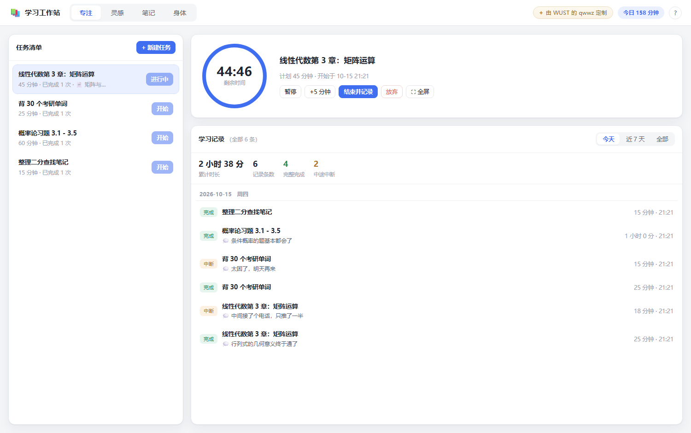
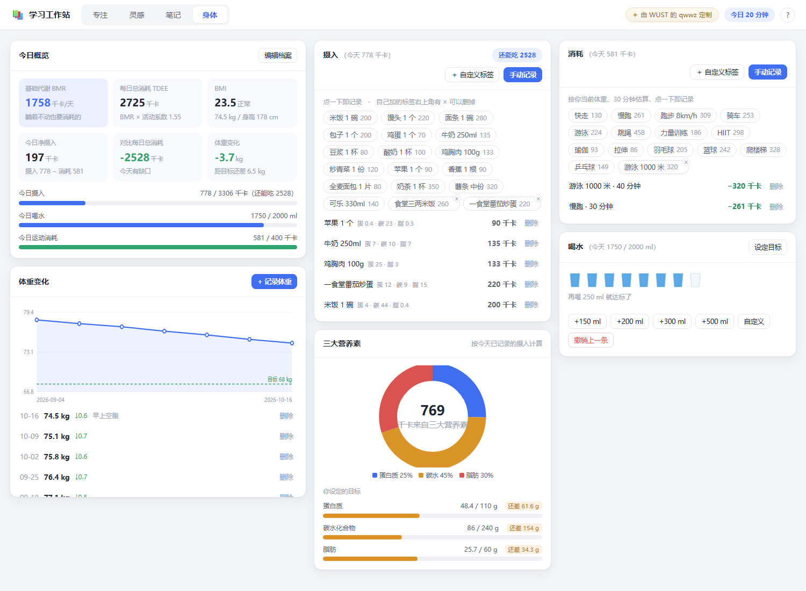
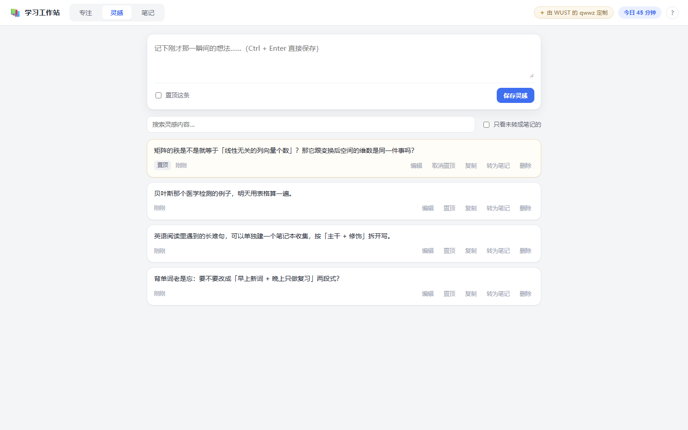
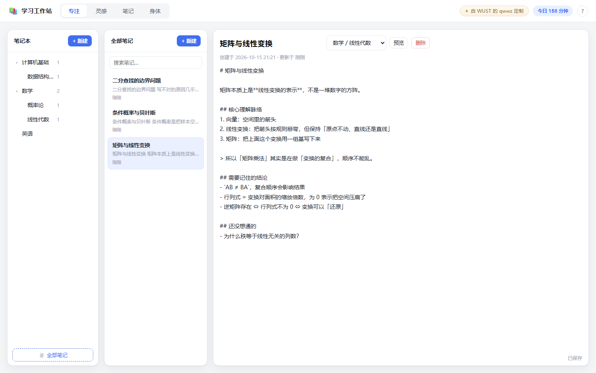

# 学习工作站

> ✦ **本软件由 WUST 的 qwwz 定制**

一款给自己用的本地工具，四个板块：

1. **专注计时** —— 写下要做的事和需要的时间，开始倒计时，结束后留下学习记录
2. **灵感速记** —— 一瞬间想到什么就立刻写下来，一键就能变成正式笔记
3. **学习笔记** —— 用笔记本一层层梳理学科脉络，支持 Markdown 和预览
4. **身体管理** —— 体重曲线、基础代谢、运动消耗、饮食摄入、喝水打卡

数据全部存在你自己电脑上的文件里，不联网、不上传、不需要注册。

## 长什么样









> 截图里是演示内容。你第一次打开时是空的，界面上有提示引导。

---

## 怎么打开

安装好 [Node.js](https://nodejs.org/)（18 或更高版本）之后：

### 方式一：双击桌面图标（推荐）

项目里有一个 **`创建桌面快捷方式.vbs`**，双击运行一次，桌面上就会出现两个图标：

| 图标 | 作用 |
| --- | --- |
| 📘 **学习工作站** | 双击打开。服务在**后台静默运行**，不会弹出黑窗口；关掉浏览器、关掉任何窗口都不会让它停下来。 |
| ⏹ **停止学习工作站** | 双击停止。会先把数据落盘再退出。 |

**再也不会出现「关掉 cmd 程序就没了」的问题**——因为根本没有窗口了。

已经开着的时候再双击「学习工作站」，它会识别到服务在跑，只帮你打开浏览器，不会重复启动。

### 方式二：直接双击项目里的 `启动.vbs`

效果和桌面图标一样。可以右键 → 发送到 → 桌面快捷方式，自己做一个。

### 方式三：`调试模式启动.cmd`（排查问题用）

会保留一个黑窗口显示程序的输出。**关掉这个窗口程序就停了**，所以平时别用它——只在打不开、想看报错的时候用。

> 命令行用户还可以 `npm start` 启动、`npm run stop` 停止。

---

## 四个板块怎么用

### 专注

1. 点「**+ 新建任务**」，写下要做什么（例如「线性代数第 3 章」）和需要多少分钟
2. 可以顺便**关联一篇笔记**，方便结束后把学习记录追加进去
3. 点「**开始**」进入倒计时

计时过程中可以：

| 按钮 | 作用 |
| --- | --- |
| 暂停 / 继续 | 暂停后剩余时间冻结，不会偷偷走掉 |
| +5 分钟 | 觉得还需要一点时间就延长 |
| 结束并记录 | 提前结束，会弹出窗口让你写两句 |
| 放弃 | 这次不计入学习记录 |
| ⛶ 全屏 | 切换到大屏倒计时（深色背景、超大数字），按 Esc 或点「退出全屏」返回 |

- 时间到了会**响一声**提醒，并弹出窗口问你「这次学到了什么」
- 在弹出窗口里写的内容，会存进当天的学习记录；如果勾了「追加到笔记」，还会自动写进关联笔记的末尾
- **刷新页面、关掉浏览器再打开，计时不会丢**（时间记在本地服务里）

**学习记录**在右下角，比以前大了很多：

- 顶部可以按 **今天 / 近 7 天 / 全部** 筛选，旁边显示累计时长、记录条数、完整完成、中途中断
- 记录按天分组，点任意一条可以**看详情**（计划时长、实际专注、开始时间、当时写的心得、关联的笔记，还能直接跳过去）
- ⚠️ **只有倒计时走完才算「完成」**；中途点「结束并记录」或「放弃」的都会标成「中断」，不计入任务的完成次数

### 灵感

- 上面的大框里想到什么就直接写，**Ctrl + Enter** 快速保存
- 每条灵感可以：置顶 / 编辑 / 复制 / **转为笔记** / 删除
- 「**转为笔记**」会弹出窗口，有两种去处：
  - **新建一篇笔记**：需要你自己**输入标题**（不再自动抄正文第一行，避免标题和正文一模一样），并选择放进哪个笔记本
  - **追加到已有笔记**：选一篇已有笔记，灵感会带上时间戳追加到它末尾，适合把零散想法归到同一主题下
- 转换过的灵感会打上「✓ 已转成笔记」的标记，也可以勾「只看未转成笔记的」来清理

### 笔记

- 左边先**建笔记本**，笔记本可以一层层嵌套（例如：数学 → 线性代数 → 特征值）
- 笔记本名字旁边的 `＋` 建子笔记本，`✎` 改名或移动，`✕` 删除
- 中间选一篇笔记，右边直接写，**输入即自动保存**（也可以按 **Ctrl + S**）
- 写的是 Markdown，点「**预览**」看排版效果：

| 写法 | 效果 |
| --- | --- |
| `# 标题` | 一级标题（`##`、`###` 依次变小） |
| `**加粗**` / `*斜体*` | 强调 |
| `- 项目` / `1. 项目` | 列表 |
| `- [ ] 待办` / `- [x] 已完成` | 可勾选的任务清单 |
| `> 引用` | 引用块，适合写「核心结论」 |
| `\| 表格 \|` | 表格，适合做对比 |
| ` ```js ... ``` ` | 代码块 |

> 小技巧：把「数学 → 线性代数 → 矩阵、特征值、二次型」这样一层层建下去，再在每篇笔记里用「核心理解脉络」+「还没想通的」两段来写，学科脉络会非常清楚。
>
> 地址栏里 `#notes/笔记ID` 是可以直接收藏的链接，下次打开会回到那篇笔记。

### 身体管理

第一次进「身体」标签会让你填一份基本档案：**性别、年龄、身高、体重、日常活动强度**，还可以设一个目标体重。

> 为什么还要性别和年龄？因为基础代谢公式（Mifflin-St Jeor）需要它们：
> 男 `10×体重 + 6.25×身高 − 5×年龄 + 5`，女 `… − 161`。
> 这些数据只存在你自己电脑上。填完之后可以随时点「编辑档案」修改。

**今日概览**会算出：

| 指标 | 含义 |
| --- | --- |
| 基础代谢 BMR | 躺着不动一天也要消耗的热量 |
| 每日总消耗 TDEE | BMR × 活动系数（1.2 久坐 ~ 1.9 极高） |
| BMI | 体重 ÷ 身高²，并按中国成人标准标出偏瘦 / 正常 / 超重 / 肥胖 |
| 今日净摄入 | 摄入 − 运动消耗 |
| 对比每日总消耗 | 今天热量是盈余还是缺口（赤字才掉秤） |
| 体重变化 | 相对第一次记录的变化，以及距目标还差多少 |

下面还有三条进度条：今日摄入（对着 TDEE + 运动消耗）、今日喝水、今日运动消耗。

**体重变化**：每次记体重会画到曲线上，绿色虚线是你的目标体重。点右上角「+ 记录体重」，同一天再记会覆盖当天那条；列表里每条都标了相对上一条的增减。

**摄入**：18 种常见食物（米饭、馒头、牛奶、鸡胸肉、奶茶……）点一下直接记账。点「**手动记录**」可以填名称、热量和三大营养素，勾上「同时存成常用标签」下次就能一键记账。

**自己加标签**：点「**＋ 自定义标签**」，填名称、热量、蛋白质/碳水/脂肪含量，保存后这个标签会一直留在那一排里，下次点一下就记账。
自己加的标签是**虚线边框**，右上角有个 **×** 可以删掉（删标签不会影响已经记下的账）。比如「食堂三两米饭 260 千卡 · 蛋白 5g · 碳水 57g · 脂肪 0.5g」这样存一次，以后天天用。

**消耗**：14 种常见运动（快走、跑步、游泳、跳绳、力量训练、HIIT……）按 MET 值和你**当前体重**自动估算 30 分钟的消耗，点一下即记录。同样支持「**手动记录**」和「**＋ 自定义标签**」（比如「游泳 1000 米 / 320 千卡」），自定义标签同样可以删除。

**三大营养素**：下方有一个环形饼图，按**各自贡献的热量**算占比（蛋白质/碳水 4 kcal/g、脂肪 9 kcal/g）：

- 饼图中心是今天从三大营养素来的总热量，下面一行是三个占比
- 饼图下面就是**达标情况**：每一项显示「已吃 / 目标 g」和「还差多少 g」，进度条未达标是琥珀色、达标变绿色
- 三项全达标会显示 🎉

**目标怎么定**：点右上角「设定目标」，三大营养素目标可以留空——**留空就用系统建议值**：

> 蛋白质 = 体重 × 1.6 g；脂肪 = 每日总消耗 TDEE × 25% ÷ 9；剩下的热量给碳水。
>
> 点一下「用系统建议值」按钮就能把这套数字填进去，也可以自己改成任何值。填了自定义值后，下面的说明会从「系统建议」变成「你设定的目标」。

**喝水**：一排杯子图标会随喝水进度逐个注满（每杯 250ml），有 +150/+200/+300/+500 快捷按钮和自定义输入，目标可以在「设定目标」里改，还支持「撤销上一条」。

> 所有食物热量、营养素含量和运动消耗都是**常见份量的近似参考值**，不同食物、不同强度差别很大，用来做趋势参考就好，别当成精确值。健康建议请以医生和专业意见为准。

---

## 数据在哪、怎么备份

所有数据都在程序目录的 **`data`** 文件夹里，是可以用记事本打开看的 JSON 文件：

```
data/
  tasks.json           任务、正在进行的计时、学习记录
  inspirations.json    灵感
  notes.json           笔记本与笔记
  health.json          身高体重档案、体重记录、摄入、消耗、喝水
  _backup/             每次保存前的自动备份（保留最近 30 份）
  .server-port         当前服务端口（临时文件，启动脚本用）
  .stop-token          停止令牌（临时文件，防止别的程序乱关）
```

- **备份**：把整个 `data` 文件夹复制到 U 盘或网盘就是完整备份
- **换电脑**：把整个文件夹拷过去，双击桌面图标即可，数据原样还在
- **恢复**：把 `_backup/` 里的某份文件改名覆盖回去就行
- 万一某个文件坏了，程序会自动把它重命名成 `.broken-时间戳` 保留现场，然后从空白开始，不会连累其他文件

### 自动快照（防止 data 整个被误删）

`data/_backup` 只能防「写坏了」，防不了「整个 data 目录被删掉」。所以程序还会把**整份数据**快照到
**`backups\`** 目录（注意：在 `data` 的**外面**）：

```
backups/
  2026-10-15_213311/   tasks.json  notes.json  inspirations.json  health.json
  2026-10-16_090412/
  ...                  最多保留 40 份，内容没变就不重复存
```

- 程序**启动时**、**每 5 分钟（有改动时）**、**正常停止时**各存一份
- 空库不存，不会堆一堆空快照
- 手动备份 / 查看：`node tools/backup-data.mjs now` 和 `node tools/backup-data.mjs list`
- **恢复**：把 `backups\<某个时间>\` 里的 json 文件复制回 `data\`，重启程序即可

> 无论用哪种方式，`data/` 和 `backups/` 都已在 `.gitignore` 里，不会被推到 GitHub。

---

## 常见问题

**双击图标没反应 / 提示找不到 Node.js？**
到 https://nodejs.org/ 装一下 LTS 版本，装完重启一次电脑再试。想看详细报错就双击 `调试模式启动.cmd`。

**提示「服务启动超过 25 秒还没有就绪」？**
多半是 7788 附近的端口被占了，程序会自己往后找（7788、7789……）。用 `调试模式启动.cmd` 启动可以从黑窗口里看到实际地址。

**怎么确认服务在跑？停止图标点了说「没有在运行」？**
正常。打开浏览器访问 http://127.0.0.1:7788/ 有界面就是跑着。

**想让浏览器别自动打开？**
命令行运行：`node server.js --no-open`

**想换个端口？**
`node server.js --port=9000`

**手机/平板能用吗？**
目前只监听本机（`127.0.0.1`），同一个局域网的其他设备访问不了。

---

## 给想改代码的人

```
server.js                  后端：零依赖 HTTP 服务 + JSON 文件存储 + REST 接口
启动.vbs / 停止.vbs         双击用的启动器和停止器（后台静默运行）
创建桌面快捷方式.vbs          在桌面生成上面两个图标
调试模式启动.cmd             保留黑窗口的启动方式，排查问题用
学习工作站.ico              应用图标
public/index.html          页面结构
public/app.css             样式
public/app.js              前端逻辑
public/markdown.js         Markdown 渲染器（浏览器和 Node 都能用）
docs/                      界面截图
tools/smoke-test.mjs       接口冒烟测试（147 项）
tools/markdown-test.mjs    渲染器单元测试（35 项）
tools/stop.mjs             命令行停止
```

> ⚠️ `启动.cmd` 一类的批处理文件里**不要写中文**：cmd.exe 是按系统代码页（这台机器是 GBK）解析 .cmd 的，
> 中文会被读乱甚至把命令拆错。中文提示都放在 `server.js` 里输出。
> `.vbs` 则相反——里面写了中文就必须存成 **UTF-16LE 带 BOM**，Windows Script Host 才认得。

跑测试：

```bash
node server.js --no-open --port=7788    # 另开一个终端
node tools/smoke-test.mjs 7788
node tools/markdown-test.mjs
```

> ⚠️ **冒烟测试会反复增删记录**。它检测到 `data` 里已经有真实内容时会**直接拒绝运行**，
> 提醒你复制一份项目到别处、在副本里跑。确实要在有数据的库上跑，确认备份后加 `--force`：
> 内容不会丢，但记录的 id 和创建时间会变。

接口一览：

| 方法 | 路径 | 说明 |
| --- | --- | --- |
| GET | `/api/all` | 一次性取回全部数据（含身体管理的计算好的指标） |
| GET | `/api/notes/:id` | 取单篇笔记的完整正文 |
| POST / PATCH / DELETE | `/api/tasks[/:id]` | 任务的增改删 |
| POST | `/api/timer/start` `pause` `resume` `extend` `stop` | 倒计时控制 |
| DELETE | `/api/sessions/:id` | 删除一条学习记录 |
| POST / PATCH / DELETE | `/api/inspirations[/:id]` | 灵感的增改删 |
| POST | `/api/inspirations/:id/to-note` | 灵感转成新笔记 |
| POST | `/api/inspirations/:id/append-to-note` | 灵感追加到已有笔记末尾 |
| POST / PATCH / DELETE | `/api/notebooks[/:id]` | 笔记本的增改删（删除会级联子笔记本） |
| POST / PATCH / DELETE | `/api/notes[/:id]` | 笔记的增改删 |
| PUT | `/api/health/profile` | 设置身高体重等档案 |
| DELETE | `/api/health/profile` | 清空档案（保留记录） |
| POST | `/api/health/weights` | 记录体重（同一天覆盖） |
| POST | `/api/health/intake` `burn` `water` | 记录摄入 / 消耗 / 喝水（摄入可带三大营养素） |
| POST | `/api/health/foods` `exercises` | 新建自定义食物 / 运动标签 |
| DELETE | `/api/health/:kind/:id` | 删除身体记录或自定义标签（kind = weights/intake/burn/water/foods/exercises） |
| PATCH | `/api/health/goals` | 设置喝水、运动消耗目标和三大营养素目标 |
| POST | `/api/shutdown` | 优雅停止（需要 `X-Stop-Token` 请求头） |
